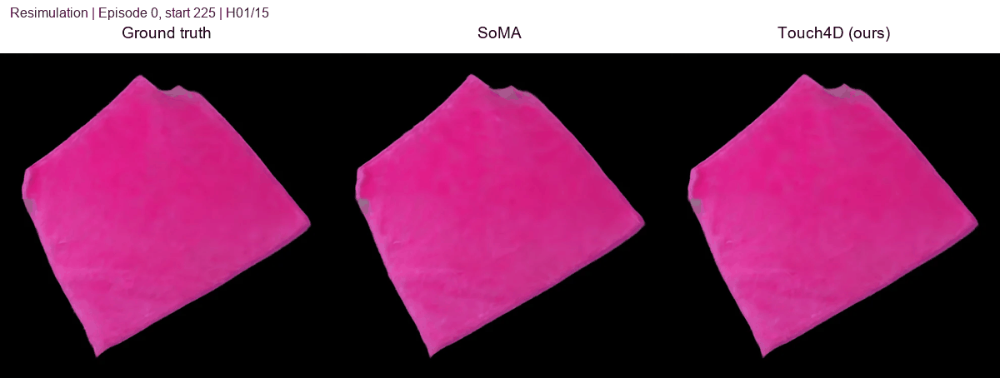
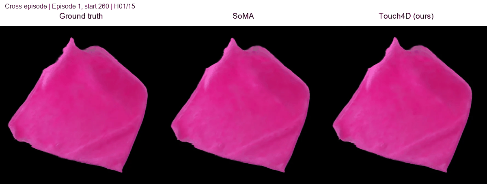

# Touch4D

**Action- and touch-conditioned cloth dynamics with 3D Gaussian representations.**

An ongoing project using real robot manipulation data from Deform360. From an initial Gaussian scene, gripper motion and tactile observations, the model predicts cloth geometry over 15 consecutive frames.

## Demo

[**Download the interactive demo**](docs/demo/comparison.html) (38 MiB). After cloning, open `docs/demo/comparison.html` in your browser to explore the frames, camera views and 3D scenes offline.

Each comparison shows **Ground truth · SoMA · Touch4D (ours)**, from left to right.

**Resimulation — Episode 0**



**Cross-episode generalization — Episode 1, same cloth**



Animations replay the existing demo frames at a slower speed for inspection. Full-resolution H15 comparisons: [resimulation](docs/assets/resimulation-h15.png) · [cross-episode](docs/assets/generalization-h15.png).

## Results

Fixed checkpoints: Touch4D E8 (1,120 updates) and SoMA Stage 2 E10 (6,000 updates after Stage 1). All metrics are lower-is-better.

**Resimulation — three training windows from Episode 0**

| Model | Mean Chamfer (mm) ↓ | H15 Chamfer (mm) ↓ | RGB MAE ↓ | Alpha MAE ↓ |
|---|---:|---:|---:|---:|
| SoMA | 3.824 | 5.173 | 0.03667 | 0.02888 |
| **Touch4D** | **2.710** | **3.062** | **0.01963** | **0.00834** |

**Cross-episode generalization — two windows from Episode 1**

| Model | Mean Chamfer (mm) ↓ | H15 Chamfer (mm) ↓ | RGB MAE ↓ | Alpha MAE ↓ |
|---|---:|---:|---:|---:|
| SoMA | 4.418 | 6.572 | 0.04087 | 0.03308 |
| **Touch4D** | **3.514** | **4.537** | **0.03117** | **0.01967** |

Mean Chamfer averages H1–H15, then weights windows equally; H15 is the final step. RGB/Alpha use target-depth-valid masks. See [raw metrics](assets/current/metrics.csv).

These are selected-window, same-object results, not a full-dataset benchmark. Training budgets and conditioning differ: Touch4D uses causal gripper/tactile inputs, while SoMA uses destination controller positions without tactile input and retains its original timing/gravity settings. RGB targets are rendered GT Gaussians, not camera photographs.

## Usage

Pipeline: [data conversion](scripts/rebuild_dataset/) → [loading](scripts/dataloader/) → [training/evaluation](scripts/training/) → [visualization](scripts/visualization/). Protocol and commands: [workflow.json](configs/workflow.json).

Data, checkpoints and the demo bundle are kept outside Git. With the retained bundle, build the standalone HTML with frame/camera controls and interactive 3D views:

```bash
python -B -m scripts.visualization.build_demo --bundle assets/current/demo_bundle.zip --output outputs/comparison.html
```

Run checks from the repository root:

```bash
python -B -m unittest discover -s scripts/tests -t .
```

GPU execution uses the [recorded PyTorch/CUDA, gsplat and SoMA environment](assets/current/runtime_environment.json). Third-party licenses are retained in [third_party/soma](third_party/soma/).
