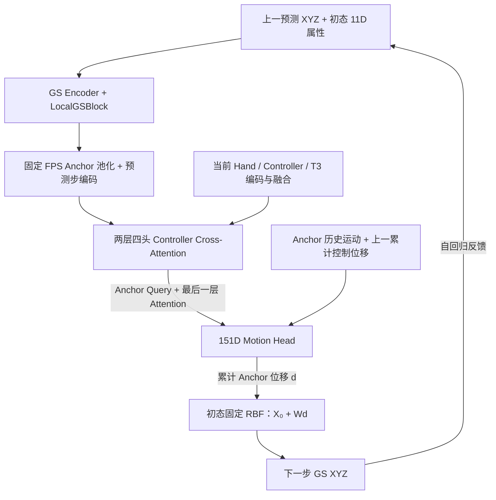
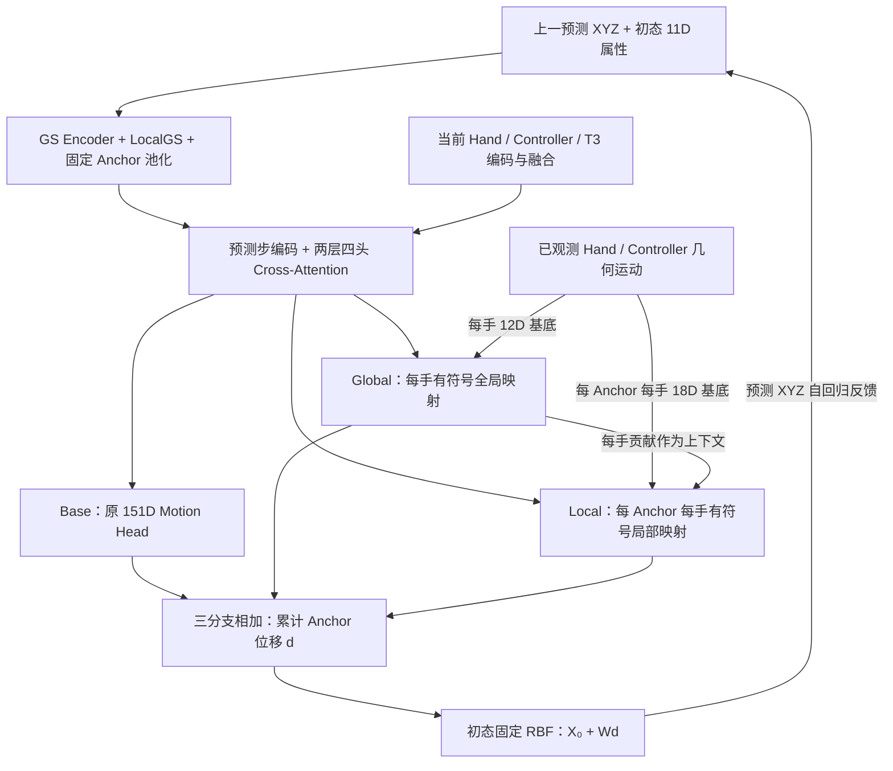

# Touch4D V4 Stage 1（G0）：H15 核心计算图

对应冻结源码 `60b7e6044a139a92bf7fdad29c262bde437ae2f9`，模型 `V4Stage1Predictor`。

**H=15，Δ=1。** 初态为第 t 帧；第 k 步读取 t+k−1 的条件，预测 t+k 的 GS。只更新 XYZ，其余 11D 属性始终继承初态。以下坐标均采用同一归一化世界坐标系。

## 1. 物体状态 → Anchor Query

初始 GS 为 14D：XYZ 3 + log-scale 3 + WXYZ quaternion 4 + opacity logit 1 + SH DC 3。

$$
G_{k-1}=[\widehat X_{k-1},\mathrm{Attr}_0],\qquad
F_{k-1}=\mathrm{LocalGSBlock}\bigl(\mathrm{MLP}_{14\to128\to128}(G_{k-1}),\widehat X_{k-1}\bigr).
$$

- LocalGSBlock：4 Head，初态固定 16NN（含 Self），使用当前预测的相对位置。
- 初态 FPS 选出最多 128 个有效 Anchor；每个 Anchor 在固定的初态 16 点邻域做均值池化。
- 池化后加入预测步 Embedding，得到 **Query `[B,128,128]`**。Anchor 身份固定，位置随预测 GS 更新；Padding 全程由 Mask 屏蔽。

## 2. 机器人条件 → Cross-Attention

| 条件 | 每个输入的维度 | 编码 |
|---|---:|---|
| 左右手 Hand State | 13：位置3＋旋转矩阵9＋开口1 | 独立 MLP `13→128→128` |
| 60 个 Controller | 13：A0 Geometry 7＋T3 Tactile 6 | 独立 MLP `13→128→128` |

A0 为当前 XYZ、相对初态累计 XYZ 和两端有效标志；T3 为 Local Mean、Local Max、Coverage、Age、Mean Valid、Max Valid。

加入 Identity/Time Embedding 后，将每个 Hand Token 投影并融合到所属的 30 个 Controller Token：

$$
\widetilde C_j=\mathrm{LN}(C_j+W_H H_{h(j)}).
$$

两层 Cross 均以 Anchor 为 Query、融合后的 Controller 为 Key/Value；每层 **4 Head，每 Head 32D**：

$$
s_{aj}^{(h)}=\frac{(q_a^{(h)})^\top k_j^{(h)}}{\sqrt{32}}
+(w_g^{(h)})^\top g_{aj}+f_{\theta,h}(q_a^{(h)},k_j^{(h)},g_{aj}),
\qquad
g_{aj}=\left[\frac{p_a-c_j}{\sigma_0},\frac{\|p_a-c_j\|^2}{\sigma_0^2}\right].
$$

评分对有效 Controller 和一个 **固定零 Logit、零 Value 的 Null** 做 Masked Softmax，再聚合 Value，经输出投影、残差及 FFN 更新 Query。初始几何权重为 `[0,0,0,−0.5]`；Q 投影与 Pairwise MLP 最后一层零初始化，随后各评分项均可训练。

单手 Episode 仅启用右手，双手 Episode 保留左右手；条件有效性与 Padding Mask 独立处理。Attention 权重表示信息关联，不等于接触概率。

## 3. Anchor Query → 累计控制位移

Motion Head 的输入严格为 **151D**：

| 输入 | 维度 |
|---|---:|
| 两层 Cross 后的 Anchor Query | 128 |
| 最后一层四个 Head 聚合的 Controller 相邻 XYZ 位移 | 12 |
| 实际 FPS Anchor 的相邻预测位置差分 | 3 |
| 上一步累计 Anchor 控制位移 | 3 |
| 四个 Head 在相邻两端均有效 Controller 上的权重质量 | 4 |
| Anchor 历史有效标志 | 1 |

工具运动保留各 Head 的独立结果，**不平均 Head，也不去掉 Null 后重新归一化**。H1 没有窗口前历史，上述运动历史输入置零。

$$
d_k=\mathrm{MLP}_{151\to128\to3}\bigl([U_k^A,m_k^{tool},\Delta\widehat p_{k-1},d_{k-1},\eta_k^{1:4},m_k^{history}]\bigr).
$$

MLP 隐藏层使用 GELU，最后一层 Weight/Bias 零初始化，因此初始完整 H15 输出等于 Copy Initial。**d 是相对初态的累计控制位移**；它不同于 FPS 所选 GS 经 RBF 混合后的实际位移。

## 4. 固定 RBF → GS → 下一步

初态确定 Anchor、带宽及 RBF 权重，整个 H15 不重建：

$$
W_{ia}=\mathrm{MaskedSoftmax}_a\left(-\frac{\|x_{i,0}-p_{a,0}\|^2}{2\sigma_0^2}\right),
\qquad
\boxed{\widehat X_k=X_0+Wd_k}.
$$

带宽 σ₀ 来自初态 Anchor 的最近其他 Anchor 距离中位数，并与 Cross 的几何评分共用。每一步都相对 **X₀** 生成中心，不把累计 d 再加到上一预测位置。

下一步重新编码 `[预测 XYZ, 初态属性]`。H15 内不 detach、不使用中间 GT Teacher Forcing，也不读取当前步尚不可用的未来条件。

训练监督保持：

$$
\mathcal L=\mathcal L_{\mathrm{CD}}+\mathcal L_{\mathrm{RGB}}+0.1\mathcal L_\alpha.
$$

CD 使用有效 GS 的双向非平方最近邻距离均值；RGB/Alpha 使用同相机、目标有效深度区域内的预测与 GT GS 渲染。GT 逐帧独立重建，不假设材料点对应。

---

# Touch4D G5-Direct：H15 核心计算图

对应正式 G5 训练源码 `f978e0a29b6f0f0b6097c40684b949797a2f5d7b`，模型 `G5DirectPredictor`。H=15、Δ=1；输入与完整输出均为 14D，**仅预测 XYZ，其余 11D 继承初态**。本节不包含 GEO Head。

G5 保留前述 G0 的编码、Cross-Attention、151D Motion Head 和固定 RBF，在累计 Anchor 位移上叠加 **G4 Global＋G5 Local**：

## 5. Base：保留原 Motion Head

Base 读取与 G0 相同的 151D 特征，输出每个 Anchor 的累计控制位移 $d^{Base}_{a,k}$。其中“上一累计控制位移”使用 **G5 上一步三分支合成后的最终 $d_{k-1}$**。

它是 G5 内联合训练的原 Motion Head，不等同于历史独立 G0 Checkpoint 的预测。

## 6. Global：每手 12D → 全局平移

左右手分别保留有符号几何运动：

| 每手基底 $b^{12}_{h,k}$ | 维度 |
|---|---:|
| 夹爪 Root 相对初态的累计 XYZ | 3 |
| Root 相对上一条件时刻的 XYZ | 3 |
| 有效 Controller 点群的平均累计 XYZ | 3 |
| 有效 Controller 点群的平均相邻 XYZ | 3 |

将全物体 Anchor Query 的有效均值、对应 Hand Token 和 12D 基底作为上下文，经共享 MLP `268→128→36`（LayerNorm＋GELU）生成每手 $3\times12$ 矩阵：

$$
\Delta T_{h,k}=M^G_{h,k}b^{12}_{h,k},\qquad
\Delta T_k=\sum_{h\in\{L,R\}}m_{h,k}\Delta T_{h,k}.
$$

左右手先独立映射再相加，不提前平均。$\Delta T_k$ 为同一步所有有效 Anchor 共享的 3D 修正。

## 7. Local：每 Anchor、每手 18D → 局部修正

对每个 Anchor 和每只手，按**当前预测 Anchor 到当前 Controller 的几何距离**计算手内 Gaussian Softmax；带宽仍为初态固定 $\sigma_0$。分别聚合累计与相邻 Controller 位移：

$$
r^A_{a,h,k}=\sum_j\beta^A_{a,h,j,k}(c_{h,j,k-1}-c_{h,j,0}),\qquad
r^\Delta_{a,h,k}=\sum_j\beta^\Delta_{a,h,j,k}(c_{h,j,k-1}-c_{h,j,k-2}).
$$

上式以窗口初态为条件时刻 0；相邻差分用于 $k\ge2$，H1 置零。两种权重分别在其位移两端都有效的节点上归一化；没有有效节点时输出零。它们独立于 Cross-Attention 的 $\alpha$，不含 Null，也不对 Far Anchor 设置距离硬门控。

$$
b^{18}_{a,h,k}=[b^{12}_{h,k},r^A_{a,h,k},r^\Delta_{a,h,k}]
\in\mathbb R^{18}.
$$

共享局部 MLP `287→128→54`（LayerNorm＋GELU）的上下文为：Query 128＋Hand Token 128＋相对几何 4＋Signed Basis 18＋Anchor 历史差分 3＋上一最终累计位移 3＋对应手 Global 贡献 3。输出重排为 $3\times18$ 矩阵：

$$
z^D_{a,h,k}=M^L_{a,h,k}b^{18}_{a,h,k},\qquad
z^{Local}_{a,k}=\sum_{h\in\{L,R\}}m_{h,k}z^D_{a,h,k}.
$$

局部 Mapping 对每个 Anchor、每只手分别应用，**G5-Direct 不新增 Anchor–Anchor Attention**。局部修正不强制零均值，因此既可调整局部形变，也可抵消部分全局平移。

## 8. 三分支合成 → RBF → 自回归

$$
\boxed{d_{a,k}=d^{Base}_{a,k}+\Delta T_k+z^{Local}_{a,k}},\qquad
\boxed{\widehat X_k=X_0+Wd_k}.
$$

三项在 Anchor 控制空间相加，随后经同一初态固定 RBF 映射为 GS 位移。下一步重新编码 `[预测 XYZ, 初态11D属性]`，并传递最终 $d_k$ 和实际 Anchor 位置历史；窗口内不 detach、不使用 GT 替换预测，也没有独立递推的 Latent Z。

H1 的新增 12D/18D 运动基底为零，Global/Local 修正严格为零，首步运动由 Base 产生。新增 Mapping 最后一层均零初始化：同共享权重下，G5-Direct 初始输出等于 G4；整个模型从头初始化时等于 Copy Initial。监督沿用前述 `CD + RGB + 0.1 Alpha`。

**G5-Propagate 的唯一附加步骤：** 在每手 Direct Seed 生成后，沿初态固定的 8NN＋Self Anchor 图进行一层有符号向量传播，再合并左右手；其他计算图不变：

$$
z^P_{a,h,k}=z^D_{a,h,k}
+0.5\sum_{b\in\mathcal N(a)}P^h_{ab,k}
\left(z^D_{b,h,k}-z^D_{a,h,k}\right).
$$

这里 $P$ 是每手独立的邻域 Attention；传播的是 3D 有符号运动种子。固定空间邻域不代表已知材料拓扑。
